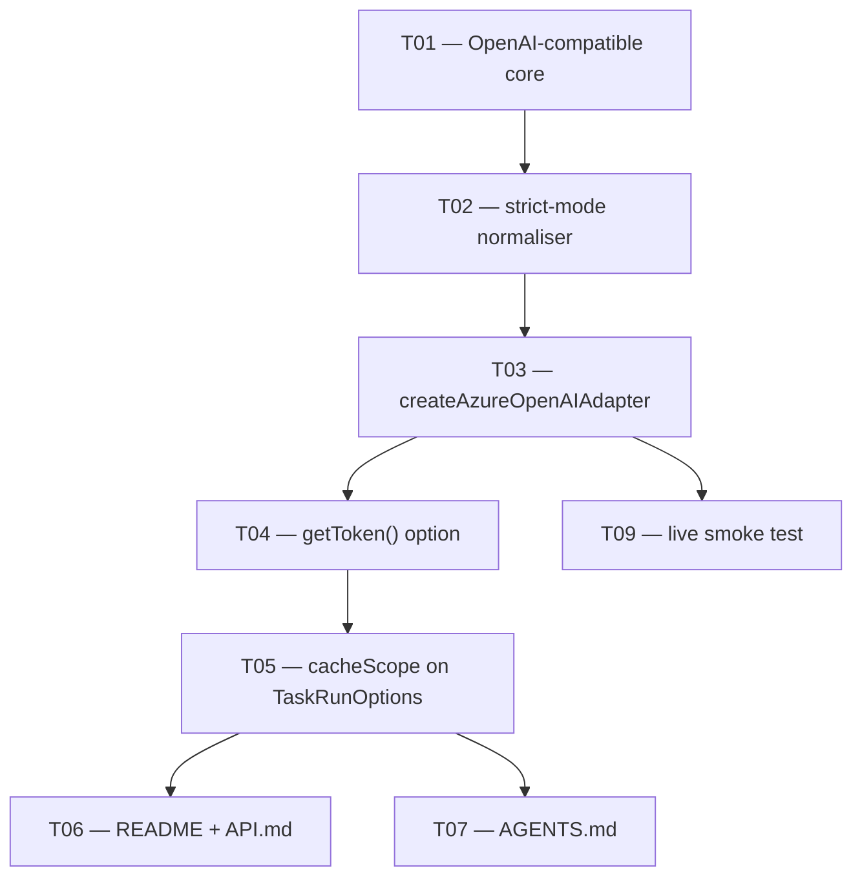

<!--
GENERATED ANALYSIS — @marianmeres/llm-task · OpenAI-compatible + Azure OpenAI adapter
Produced 2026-09-03 by inline research → verify pass against the working tree → synthesize.
Claims verified against the codebase at commit 9ea4d90. Planning artifact; no code was changed.
-->

# Azure adapter — Analysis Overview & Roadmap

> The package is in good shape for this work. The adapter contract is genuinely thin, the
> policy layer already handles everything an adapter must not, and the one shipped real
> adapter is a clean template. Nothing here is a refactor; almost all of it is additive.
>
> **The critical path is three tasks.** An OpenAI-compatible core, a strict-mode schema
> normaliser, and an Azure factory over the top. That is the whole deliverable the customer
> project depends on, and it is roughly 250 lines of source plus tests. Everything else in
> this plan is either a contract improvement that can wait or documentation that must
> happen before a release but blocks nobody.
>
> **Every open question is closed.** The decision sweep ran on 2026-09-03: cache
> partitioning is `cacheScope` on `TaskRunOptions`, documented rather than enforced; the
> parameterised builder is exported publicly; and the example app gets no Azure entry,
> because a browser call needs resource-side CORS that a registry entry cannot declare. All
> eight rows in the tracker are `⬜`, with the rationale for each call in its Decisions log.
>
> **One caveat about the harness.** At eight tasks this sits just above the threshold where a
> plan set earns its keep, and the first three rows are the whole customer-facing
> deliverable. If you would rather work those three by hand in a session or two, that is the
> faster path — the documents are still worth having as the record. The harness pays off
> most for the five rows after them, which are the parts that otherwise sit unwritten.

## Top recommendations across all dimensions (ranked)

| Rank | Recommendation                                 | Dimension (doc)                              | Value | Effort | Risk | Why now                                                                 |
| ---- | ---------------------------------------------- | -------------------------------------------- | ----- | ------ | ---- | ----------------------------------------------------------------------- |
| 1    | OpenAI-compatible core + `createOpenAIAdapter` | [01](./01-openai-compatible-adapter.md) #1   | high  | M      | low  | Everything else depends on it; also unlocks Groq/OpenRouter/Ollama free |
| 2    | OpenAI strict-mode schema normaliser           | [01](./01-openai-compatible-adapter.md) #2   | high  | M      | med  | Structured classification is the customer project's core requirement    |
| 3    | `createAzureOpenAIAdapter`                     | [01](./01-openai-compatible-adapter.md) #3   | high  | S      | low  | The actual deliverable; trivial once 1 and 2 exist                      |
| 4    | README + API.md                                | [03](./03-surface-docs-and-example.md) #1    | high  | S      | low  | Exports land in JSR's type surface whether or not prose mentions them   |
| 5    | `getToken()` adapter option                    | [02](./02-adapter-contract-extensions.md) #1 | med   | S      | low  | Needed for a service principal rather than a shared static key          |
| 6    | AGENTS.md wire-format section                  | [03](./03-surface-docs-and-example.md) #2    | med   | S      | low  | Stops the next agent session re-deriving the mapping from source        |
| 7    | Live smoke test against a real deployment      | [03](./03-surface-docs-and-example.md) #4    | med   | S      | low  | The normaliser is the part offline tests can least validate             |
| 8    | Cache scoping for dynamic-identity adapters    | [02](./02-adapter-contract-extensions.md) #2 | med   | M      | med  | Latent today; `getToken()` is what makes it reachable                   |

**Deliberately not done.** An Azure entry in the example app's live-provider picker — a
browser call needs CORS configured on the Azure resource, which a registry entry cannot
declare, so the entry would fail for every reader who has not configured their own resource,
and fail as an unexplained retry storm. Reasoning recorded in
[03 #3](./03-surface-docs-and-example.md); the AGENTS.md note is part of T07.

**Deliberately omitted.** Wiring `capabilities.jsonMode` into the client's schema strategy
— the client never reads that flag ([`src/client.ts:437`](../../src/client.ts) consults
only `jsonSchema`), and `json_object` mode adds nothing the existing prompt instruction
does not already say. Reasoning recorded at [01 #4](./01-openai-compatible-adapter.md) so
it reads as considered rather than missed.

## Start with these three

**T01 — OpenAI-compatible core + `createOpenAIAdapter`.** First because everything else
imports it. The core is parameterised by the three things that vary between OpenAI-shaped
providers — URL shape, auth header, whether `model` is sent — so Azure becomes a config
object rather than a second adapter. Ships deliberately _without_ native structured output
(`capabilities.jsonSchema: false`), which keeps the commit small and leaves structured
tasks on the client's existing prompt strategy. Detail in
[01 #1](./01-openai-compatible-adapter.md).

**T02 — OpenAI strict-mode schema normaliser.** The second half of T01, split out because
it has distinct semantics and its own test surface. OpenAI strict mode differs from
Anthropic's restrictions in one substantial way — every key in `properties` must also
appear in `required` — so the existing `normalizeJsonSchema` cannot be reused. This commit
adds the normaliser and flips `capabilities.jsonSchema` to `true`. Detail in
[01 #2](./01-openai-compatible-adapter.md).

**T03 — `createAzureOpenAIAdapter`.** Small once T01 and T02 exist: an endpoint, an
`api-key` header instead of a bearer, and a deployment name where a model id would go.
Defaults to Azure's `/openai/v1/` surface with an optional `apiVersion` that switches to
the classic deployment route, which sidesteps having to pick one up front. Detail in
[01 #3](./01-openai-compatible-adapter.md).

Together these are the customer project's dependency, and they de-risk the part of it that
is least visible from outside: whether a strict JSON schema round-trips correctly. The
remaining five rows — `getToken()`, `cacheScope`, the live smoke test and the two
documentation rows — sit in the same sprint section behind them, in that order, so all code
lands before anything documents it.

## Cross-cutting themes

**Laziness is already the pattern, and it is what makes the extensions cheap.** Credentials
are resolved inside `complete()`, not at construction
([`anthropic.ts:96`](../../src/adapters/anthropic.ts)). That is why `getToken()` costs one
`await` rather than a redesign, and why an explicit key never touches the environment.

**Refusal over silent rewriting.** The Anthropic normaliser throws `InvalidRequestError`
rather than destroy the semantics of a record/map schema
([`anthropic.ts:283`](../../src/adapters/anthropic.ts)). The OpenAI normaliser must hold
the same line. This is an established property of the package and the easiest one to
erode by accident.

**The adapter stays dumb.** Token caching, refresh-ahead, retry-on-401 — all policy, none
of it in an adapter ([`src/adapter.ts:74`](../../src/adapter.ts)). Every extension in this
plan was checked against that rule; the one place it bites is `getToken()`, where the
temptation to cache the token inside the adapter should be refused and pushed to the
caller.

**`fingerprint` is the cache's only notion of adapter identity, and it is static.** Fine
for every adapter shipped today. Doc 02 #2 is the whole discussion of what happens when it
stops being fine.

## Dependency / sequencing notes

T05 is drawn dashed from T04 because it is not a build dependency — it is a _hazard_
dependency. `getToken()` is what makes the cache-scoping bug reachable in practice, so T05
should not lag far behind T04 even though nothing fails to compile without it.

Every edge above is mirrored into the `Deps` column of
[`PROGRESS.md`](./PROGRESS.md), which is what actually holds the order.

## Completeness check

Two gaps found while cross-reading the dimension docs, both now folded in:

- Doc 01 originally treated the schema normaliser as part of the core adapter task. Doc 03's
  live-smoke finding made the case for splitting it: the normaliser is the component offline
  tests validate least well, so it deserves its own commit boundary and its own live
  assertion. Split into T01/T02, and [03 #4](./03-surface-docs-and-example.md) now
  specifically calls for a structured-output live assertion.
- Doc 02's `getToken()` finding and doc 03's example-app finding both touch credential
  handling but from opposite ends. The example app's key-handling invariants assume a
  static pasteable secret; `getToken()` does not fit that UI at all. Not a conflict — the
  example simply stays on `apiKey` — but worth recording so nobody later tries to wire a
  token callback into a password field.

No gap found around `batch()`, `cleaners`, `errors` or the retry/deadline policy: none of
them are provider-aware, and none need to change for a new adapter. Stated explicitly
because "did the new provider need a policy change?" is the obvious question and the
answer is genuinely no.

Source documents: [`01-openai-compatible-adapter.md`](./01-openai-compatible-adapter.md),
[`02-adapter-contract-extensions.md`](./02-adapter-contract-extensions.md),
[`03-surface-docs-and-example.md`](./03-surface-docs-and-example.md).
